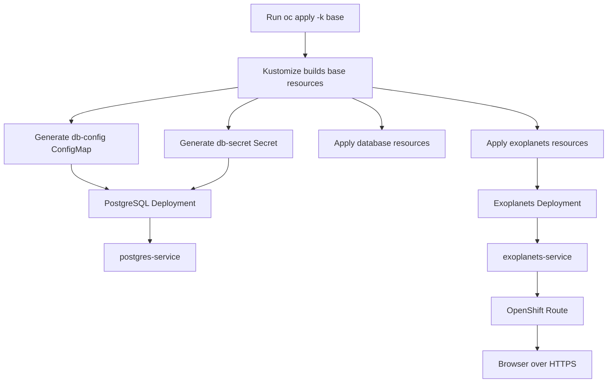

# Exoplanets App — OpenShift Deployment

This repository uses Kustomize to deploy an Nginx web container and a PostgreSQL database to OpenShift. The web application is exposed through an OpenShift Route with edge TLS.

## Deployment workflow



## Resources

| Resource | Purpose |
| --- | --- |
| `base/database/deployment.yaml` | Runs PostgreSQL. Loads settings from the generated ConfigMap and Secret. |
| `base/database/configmap.yaml` | Defines the PostgreSQL database name and user. |
| `base/database/service.yaml` | Provides internal access to PostgreSQL on port `5432`. |
| `base/exoplanets/deployment.yaml` | Runs two replicas of the unprivileged Nginx image on port `8080`. |
| `base/exoplanets/service.yaml` | Exposes the web pods internally on port `80`, forwarding to `8080`. |
| `base/exoplanets/route.yaml` | Exposes the web Service through an OpenShift Route with edge TLS. |
| `base/kustomization.yaml` | Combines the components and generates the database ConfigMap and Secret. |

## Requirements

- Access to an OpenShift cluster.
- The `oc` CLI, authenticated to the target cluster.
- Permission to create Deployments, Services, Routes, ConfigMaps, and Secrets in the target project.

## Deploy

Select the OpenShift project, then apply the Kustomize configuration:

```bash
oc project <project-name>
oc apply -k base
```

Preview the rendered resources without applying them:

```bash
oc kustomize base
```

## Verify

Check the application and database pods:

```bash
oc get pods
```

Check that the web Service has pod endpoints:

```bash
oc get endpoints exoplanets-service
```

Get the generated Route host:

```bash
oc get route exoplanets-route
```

Open the Route host in a browser using HTTPS. The Route is configured to redirect HTTP requests to HTTPS.

Check pod logs if a workload is not starting:

```bash
oc logs deployment/exoplanets-app -c web
oc logs deployment/postgres-db -c postgres
```

## Configuration and security notes

- Kustomize generates a Secret named `db-secret` from values in `base/kustomization.yaml`. Replace example credentials with secure values before deploying, and avoid committing real credentials to source control. For production, use an approved secret-management solution.
- The PostgreSQL Deployment consumes `POSTGRESQL_USER` and `POSTGRESQL_DATABASE` from `db-config`, and `POSTGRESQL_PASSWORD` from `db-secret`.
- The web Deployment sets `DB_HOST=postgres-service`. The manifests do not configure application code or additional database credentials for the web container; configure those if the application needs to connect to PostgreSQL.
- The web Service listens on port `80` and forwards to the container on `8080`. The Route targets the Service's `8080` endpoint port as currently configured and routes traffic to the web Service.
- For production, consider pinning container images to a specific version or digest instead of using a floating tag.

## Remove the deployment

Remove the resources managed by this Kustomize configuration:

```bash
oc delete -k base
```